<div align="center">


<br>

[](https://agent-dashboard-pi-seven.vercel.app)
[](https://www.npmjs.com/package/agent-party-dashboard)
[](#quick-start)
[](#how-it-works)
[](LICENSE)
[](https://agent-dashboard-pi-seven.vercel.app)

**A zero-dependency, pixel-art dashboard that shows every AI coding agent on your machine,<br>what it is doing right now, how much context it has left, and how hard your hardware is working.**

```bash
npx agent-party-dashboard
```

[Try the demo](https://agent-dashboard-pi-seven.vercel.app) · [Quick start](#quick-start) · [Supported tools](#supported-tools) · [Approvals](#approve-from-the-dashboard) · [Watchtower](#watchtower) · [The Vizier](#the-vizier) · [Hall of Fame](#hall-of-fame) · [Write an adapter](ADAPTERS.md)

<br>

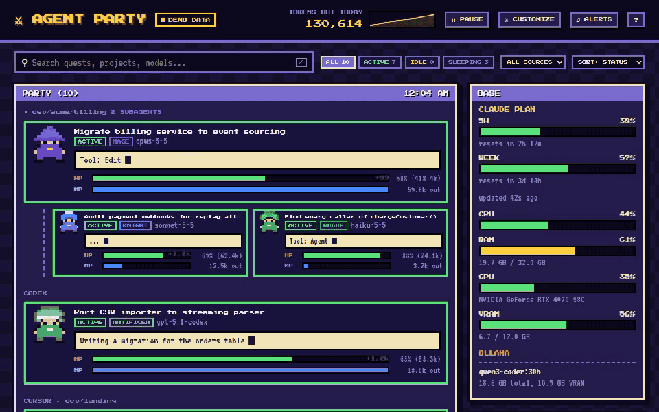

</div>

<br>

## Why

Running several Claude Code sessions, a handful of subagents, a Codex job and a Cursor chat at the same time gets hard to follow from terminal tabs and editor panels. Agent Party reads the session logs those tools already write and turns them into one live screen: who is working, who is waiting for you, who is about to run out of context, what each one is doing right now, and what it all would cost at API prices.

Two ways to look at it: the **Party** view, where every agent is an RPG character, and the **Cosmos** view, where every project is a solar system.

Each agent is a party member. Its **HP** is the context window it has left, its **MP** is the tokens it has produced, and its class comes from the model behind it. You can [change any of them](#customize-your-party).

| Class | Default for | | Class | Default for |
| :-- | :-- | :-: | :-- | :-- |
| 🟣 **Mage** | Claude Opus | | 🩵 **Artificer** | GPT, Codex, o-series |
| 🔵 **Knight** | Claude Sonnet | | ⚪ **Cleric** | Gemini |
| 🟢 **Rogue** | Claude Haiku | | 🟠 **Beast** | Anything else |
| 🟡 **Sage** | Claude Fable | | 🔴 🖤 🩷 | **Barbarian**, **Necromancer**, **Bard**: yours to assign |

## Features

<table>
<tr>
<td width="50%" valign="top">

**🗡️ Party view**
- Sessions from [7 tools](#supported-tools) over the last 24 hours, in one view
- Subagents nested under the session that spawned them, collapsible per project
- Live activity bubble: the current tool call or the latest line of output
- Floating `+1.2k` token gains and a spawn animation when a subagent joins
- Hide finished sessions (and their subagents) from the board with one click on the eye

**🔎 Find things fast**
- Search across titles, prompts, projects, models and session IDs
- Status filters with live counts: active, idle, sleeping
- Sort by status, recency, tokens or context pressure
- Filters and collapsed groups persist between visits

</td>
<td width="50%" valign="top">

**🛎️ Watchtower**
- Flags agents that need you: waiting on an approval, asking a question, or with a plan to review
- Spots stuck agents (the same call over and over, or a run of failures) and two agents editing the same file
- Forecasts how many turns a session has before its context fills, and when your Claude plan limits run out
- Dismiss any alert with one click

**♔ The Vizier**
- End-of-day Quest report per project: what each agent did, files changed, commits and cost
- Treasury budgets per day and per project, with desktop notifications at 80% and 100%
- Session timelines to scrub through every tool call, result and error
- Day replay: a time-lapse of the whole party, with commits as they land

**✅ Approvals, even from your phone**
- Approve or deny Claude Code's permission prompts from the dashboard
- Pair a phone on your Wi-Fi and answer from the couch; add it to your home screen like an app

**★ Hall of Fame**
- Every model levels up with the tokens it produces, for life
- 12 achievements, from Night Owl to Swarm
- Wrapped: a shareable pixel-art card of your week or month
- Optional 8-bit sound effects and a chiptune loop

**📜 Quest log and alerts**
- Running feed of agents joining, finishing a turn, waking up and going idle
- On-screen toasts, plus optional desktop notifications when an agent finishes while the tab is in the background
- Active agent count in the browser tab title

**🧭 Agent details**
- Click any card for the original prompt, model, context, tokens, estimated cost and last-seen time
- One-click copy of the session ID or the exact `claude --resume` / `codex resume` command

**🎨 Customize your party**
- Ten classes per model in Party view; star type, planet type, moons and color in Cosmos view
- Share your setup with a link

**🌌 Cosmos view**
- Projects become solar systems: the session is the sun, subagents orbit as planets
- Sleeping subagents drift into an asteroid belt; big sessions abandoned for 30+ days collapse into black holes

**📈 Chronicle**
- Usage history: LIVE, 24 hours, 7 days or 30 days, in tokens or estimated cost
- Top models and projects, busiest hours, and a table view

**🏰 Base panel**
- Claude plan usage for the 5-hour and weekly windows, with reset countdowns
- CPU, RAM and every GPU (NVIDIA, Apple Silicon, AMD, Intel), plus the models Ollama has loaded

</td>
</tr>
</table>

<div align="center">

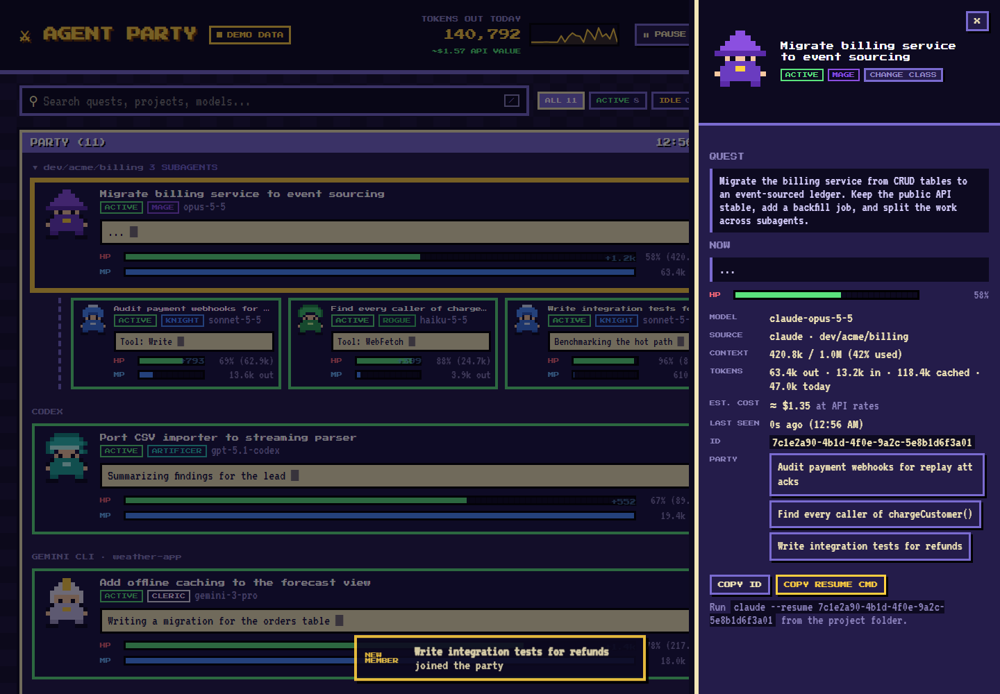
</div>

## Quick start

```bash
npx agent-party-dashboard
```

Your browser opens on **http://127.0.0.1:4300**. That's it: no install, no build step, no config. It needs Node 22.13 or newer.

<details>
<summary><b>Options</b></summary>

<br>

```text
npx agent-party-dashboard --port 4400        # another port
npx agent-party-dashboard --no-open          # don't open the browser
npx agent-party-dashboard --disable cursor   # skip some adapters
npx agent-party-dashboard --test-notify      # check that desktop notifications work
npx agent-party-dashboard --install-hooks    # answer Claude Code permission prompts from the dashboard
npx agent-party-dashboard --lan              # let a paired phone on your Wi-Fi open it
npm i -g agent-party-dashboard && agentparty # install once, run anywhere
```

Or run it from a clone: `git clone https://github.com/jvitorbarros15/agent-dashboard.git && cd agent-dashboard && node server.mjs`.

</details>

## Supported tools

| Tool | What it reads | Subagents | Context | Tokens | History & cost | Watchtower & Vizier |
| :-- | :-- | :-: | :-: | :-: | :-: | :-: |
| **Claude Code** | `~/.claude/projects/**/*.jsonl` | ✅ | ✅ | ✅ | ✅ | ✅ |
| **Codex CLI** | `~/.codex/sessions/**/*.jsonl` | ✅ | ✅ | ✅ | ✅ | ✅ |
| **Cursor** | Cursor's `state.vscdb` (read-only) | ✅ | ✅ % | ✅ | | |
| **Gemini CLI** | `~/.gemini/tmp/*/chats/*.json` | | ✅ | ✅ | | |
| **Cline** / Roo Code | Editor `globalStorage/.../tasks/*` | | ✅ | ✅ | | |
| **Aider** | `.aider.chat.history.md` in your repos | | | ✅ | | |
| **OpenCode** | `opencode.db` (read-only) | | | ✅ | | |

Using something else? An adapter is one small file. See **[ADAPTERS.md](ADAPTERS.md)**: drop it into `~/.agent-party/adapters/` and it loads on the next start.

> [!TIP]
> Aider writes its history inside each repo, so Agent Party looks two folders deep under your home and common code folders. Point it elsewhere with `AGENT_PARTY_AIDER_DIRS=/path/one:/path/two`.

## Cosmos view

Press <kbd>T</kbd> or click **COSMOS** to swap the party for a star map. Same data, same filters, same detail panel.

<div align="center">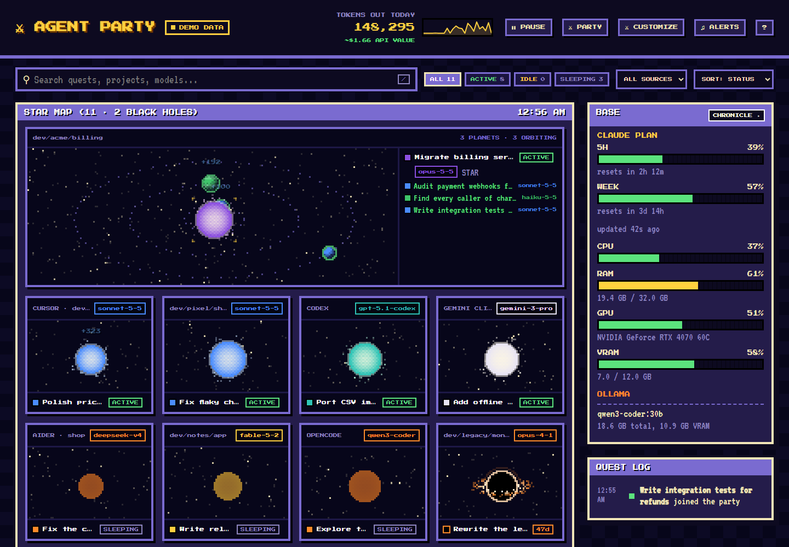</div>

<br>

| You see | It means |
| :-- | :-- |
| ☀️ **Star** | A main session. Bigger means more tokens; a flickering corona means it's working right now |
| 🪐 **Planet** | A subagent. Orbit speed shows activity, size shows tokens, the glow around it shows context left |
| 🌑 **Asteroid** | A subagent that went to sleep, drifting in the outer belt |
| ☄️ **Comet** | A subagent that just spawned, flying in to take its orbit |
| 🕳️ **Black hole** | A session with lots of work that has been abandoned for 30+ days |

Every tile carries a badge with the model's name, and <kbd>C</kbd> opens a Cosmos version of Customize: star type (yellow dwarf, red giant, blue giant, white dwarf, pulsar), planet type (rocky, gas giant, ice, ringed, lava, ocean), moons and colors, plus the colors of comets and black holes.

> [!NOTE]
> Claude Code deletes transcripts after `cleanupPeriodDays` (30 by default), so Claude black holes only appear if you keep them longer. Cursor and Codex keep their history.

## Chronicle: history and cost

Press <kbd>H</kbd>, click the token counter in the header, or click **CHRONICLE** in the Base panel.

<div align="center">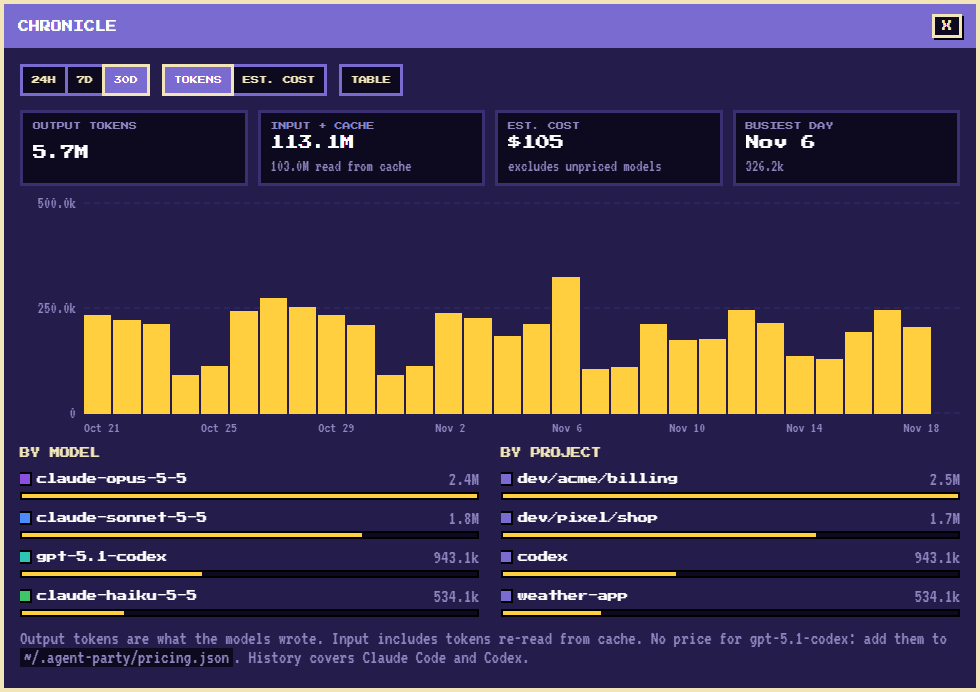</div>

<br>

- **LIVE**, **24H**, **7D** and **30D** ranges, measured in output tokens or estimated cost, with a table view. The header sparkline follows your choice: LIVE shows the last 15 minutes, anything else the last 24 hours.
- **Estimated cost** uses Anthropic's published API prices, cache reads and writes included. On a subscription you're billed differently, so read it as the API value of your work.
- Other models (GPT, Gemini, local models…) show as unpriced until you add them:

```jsonc
// ~/.agent-party/pricing.json  (USD per million tokens)
{ "gpt-5.1-codex": { "input": 1.25, "output": 10, "cacheRead": 0.125 } }
```

## Watchtower

The bar above the party watches every session and tells you when something needs a human. Click an alert to open that agent, or **X** to dismiss it. A dismissed alert only comes back if something new happens. Press <kbd>5</kbd> to filter the party down to flagged agents.

<div align="center">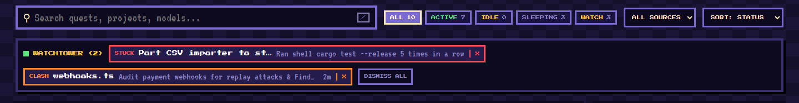</div>

<br>

| Alert | When it fires |
| :-- | :-- |
| `NEEDS YOU` | An agent is waiting on a tool approval, asked you a question, has a plan ready, or finished its turn with a question |
| `STUCK` | The same tool call 4 times in a row, or 4 failed calls in a row |
| `CLASH` | Two agents edited the same file within a few minutes of each other |

Each agent's details also show **turns until full**, a forecast of when its context window fills up and compacts, and the Base panel forecasts whether your 5-hour and weekly Claude limits run out before they reset.

## The Vizier

The king's right hand keeps the books. Press <kbd>V</kbd> or click **VIZIER**.

<div align="center">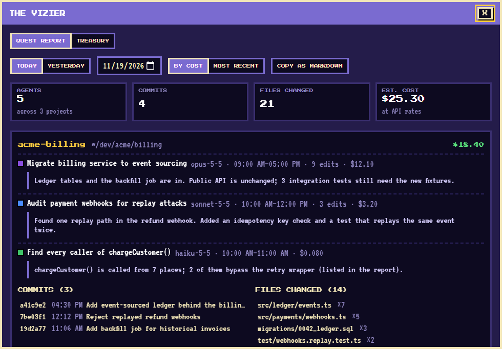</div>

<br>

- **Quest report.** Everything that happened on a day, grouped by git repository: each agent's task and last words, the files it touched, the commits made that day and the estimated cost. Sort by cost or by most recent, pick any day, and **COPY AS MARKDOWN** for a standup or a journal.
- **Treasury.** Set a daily limit and a limit per project, then press **SET**. At 80% and at 100% you get a toast, a chime and a native desktop notification. Limits are saved in `~/.agent-party/budgets.json` and checked by the server, so the notification arrives even with the dashboard closed, as long as Agent Party is running. Limits are alerts at API prices: they never stop an agent.
- **Timelines.** Open an agent's details and click **TIMELINE** to step through every prompt, tool call, result and error in order. Filter to tools or errors, jump to the next error, or scrub with the slider and arrow keys. Available for Claude Code and Codex.

<div align="center">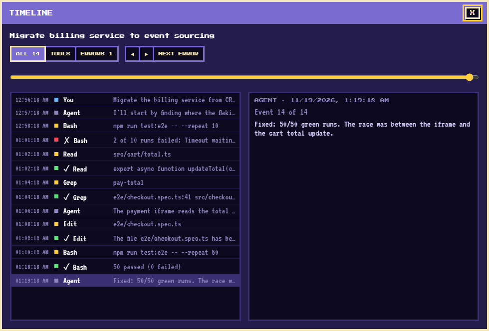</div>

- **Replay.** The REPLAY tab plays the day back as a time-lapse: agents appear when they start, hop while they work, doze off when they go quiet, and commits show up as they land. Scrub to any minute or pick a speed.

<div align="center">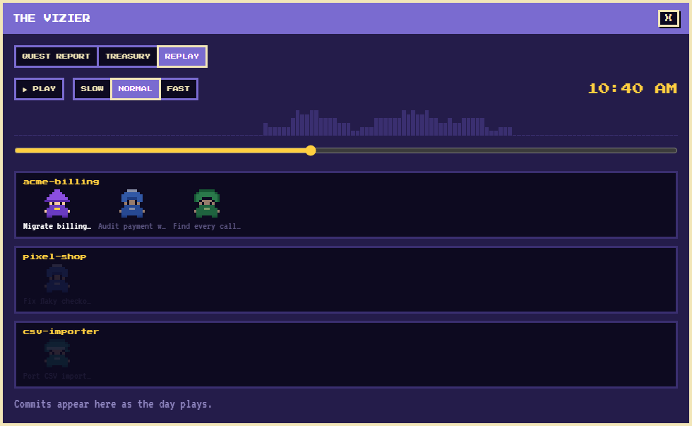</div>

## Approve from the dashboard

When Claude Code is about to ask for permission, the request can show up at the top of the Watchtower instead, with **APPROVE**, **ALWAYS** (approve and save the rule), **DENY** and **TERMINAL** (let Claude Code ask in the terminal as usual).

<div align="center">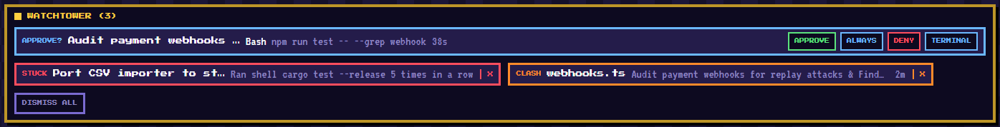</div>

<br>

It works through a Claude Code [hook](https://code.claude.com/docs/en/hooks). Install it once:

```bash
npx agent-party-dashboard --install-hooks
```

It shows the exact change, asks before writing, and backs up `~/.claude/settings.json` first. `--uninstall-hooks` takes it out again. Restart running Claude Code sessions afterwards.

- The hook only waits when a dashboard is open. If none is, Claude Code asks in the terminal straight away.
- While a request is on the dashboard, Claude Code's own prompt waits for it. Answer it there, or click **TERMINAL** to hand it back. Unanswered requests go back to the terminal after 100 seconds.
- Questions (`AskUserQuestion`) and plan approvals always stay in the terminal.
- Using another port? Install with the same flag: `--install-hooks --port 4400`.

### On your phone

Watch your party and answer approvals from your phone, at home or anywhere.

1. **Start Agent Party with phone access:**
   ```bash
   npx agent-party-dashboard --lan
   ```
   On Windows, allow Node through the firewall on private networks if asked.
2. **Find the address and code.** On your computer, open the dashboard and look in the **Base** panel under **PHONE**. It shows your Wi-Fi address (like `http://192.168.1.20:4300`) and a 6-digit pairing code. The terminal prints them too.
3. **Open the address on your phone** (same Wi-Fi) and enter the code. Done: that phone can now see your agents and tap APPROVE or DENY.
4. **Make it an app.** Use **Add to Home Screen** (Safari's share menu on iPhone, Chrome's menu on Android). On iPhone, open it from the new icon and enter a code once more, because home screen apps keep their own storage.

**Away from home:** install [Tailscale](https://tailscale.com) (free) on the computer and the phone, signed in to the same account. The Base panel then also shows a `100.x` address. Use that one instead and it works from anywhere, over mobile data too, without opening anything to the internet.

**Safe by default.** Devices that haven't paired see only the pairing screen. Each code works once, a new one appears after every pairing or after 5 wrong tries, and paired devices stay paired when you restart. Without `--lan`, nothing outside your computer can connect at all.

## Hall of Fame

Press <kbd>L</kbd> or click **HALL**.

<div align="center">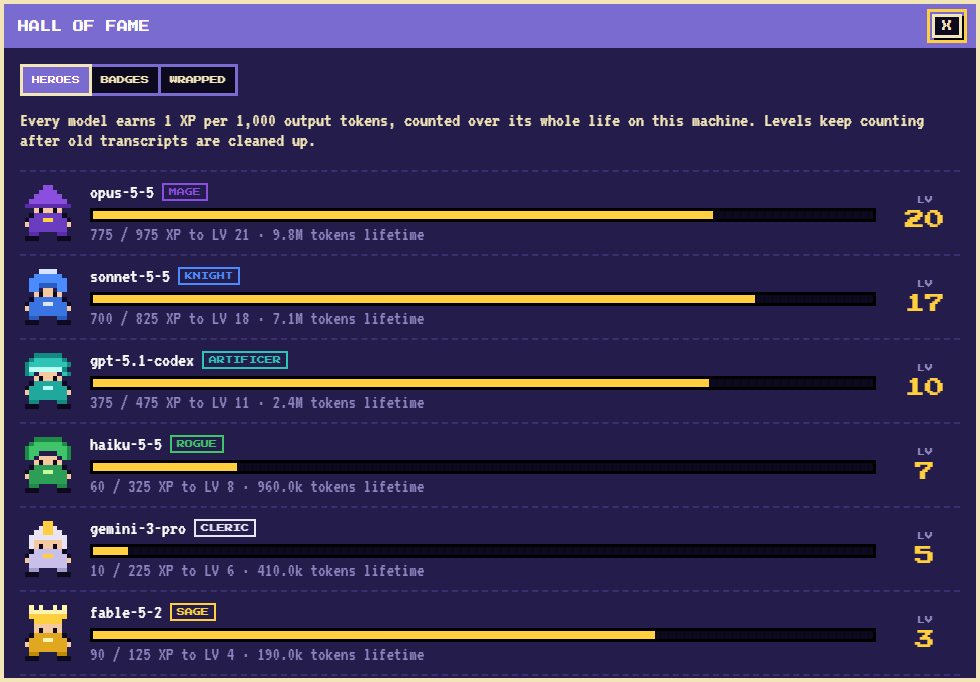</div>

<br>

- **Heroes.** Each model earns 1 XP per 1,000 output tokens and levels up over its lifetime on your machine. The count lives in `~/.agent-party/profile.json`, so it keeps going after tools clean up old transcripts. Cards show the level next to the class.
- **Badges.** Twelve achievements, like **Night Owl** (agents working past midnight), **Million Club** (a million output tokens in a day), **Swarm** (10 subagents under one session) and **Marathon**. Unlocks and level-ups pop up with a fanfare.
- **Wrapped.** A 1080×1350 card of your week or last 30 days: tokens, cost, busiest hour and day, your MVP model and the party lineup. Project names are hidden unless you untick the box. **DOWNLOAD PNG** or **COPY IMAGE** and post it.

<div align="center">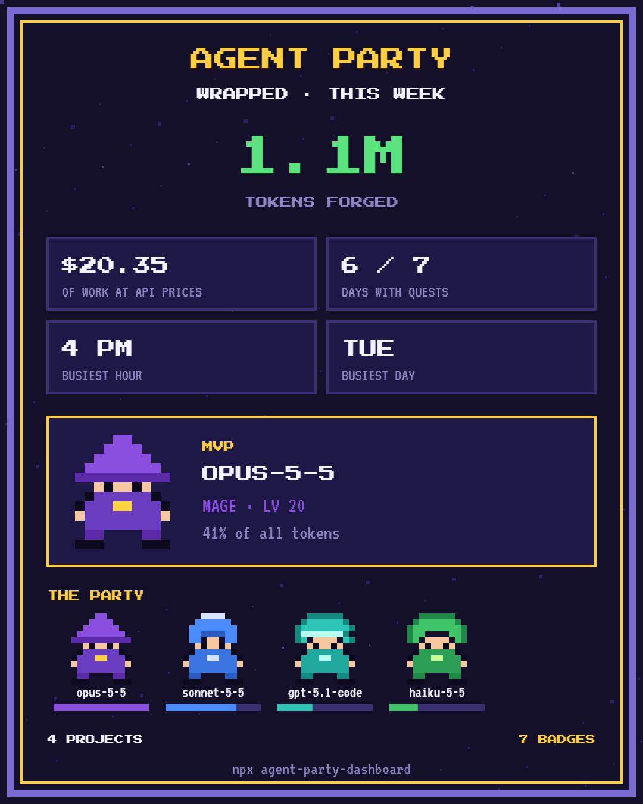</div>

<br>

Press <kbd>M</kbd> for sound: off, 8-bit effects (a tick on every button, a chirp pitched by class when you pick an agent, and in Cosmos a chord for stars, a ping for planets, a thud for asteroids and a deep fall into black holes; you can even click a passing comet, plus joins, finished turns, alerts and level-ups), or effects plus a chiptune loop. Everything is synthesized in the browser.

## Customize your party

Press <kbd>C</kbd> or click **CUSTOMIZE** to pick a class and color for each model you use. Choices are saved in your browser, and **COPY SHARE LINK** gives you a URL that loads your party on anyone else's dashboard.

<div align="center"></div>

### Connect the hosted dashboard to your machine

The [hosted copy](https://agent-dashboard-pi-seven.vercel.app) runs on simulated data, since a website can't read files on your computer. To point it at your real agents, allow its origin when you start the local server:

```bash
DASHBOARD_ORIGINS=https://agent-dashboard-pi-seven.vercel.app npx agent-party-dashboard
```

Then click the **DEMO DATA** badge and choose **Connect**, or open `https://agent-dashboard-pi-seven.vercel.app/?api=http://127.0.0.1:4300`. Chrome asks once for permission to reach your local network.

> [!IMPORTANT]
> The local API only answers cross-origin requests from origins listed in `DASHBOARD_ORIGINS`. Other websites you visit can't read your session data.

## Keyboard shortcuts

| Key | Action | | Key | Action |
| :-: | :-- | :-: | :-: | :-- |
| <kbd>/</kbd> | Search | | <kbd>J</kbd> <kbd>K</kbd> | Select next / previous agent |
| <kbd>1</kbd>–<kbd>5</kbd> | All / active / idle / sleeping / watch | | <kbd>Enter</kbd> | Open selected agent |
| <kbd>S</kbd> | Cycle sort order | | <kbd>Esc</kbd> | Close panel, clear search |
| <kbd>P</kbd> | Pause live updates | | <kbd>?</kbd> | Show all shortcuts |
| <kbd>N</kbd> | Toggle "agent finished" alerts | | <kbd>C</kbd> | Customize classes and colors |
| <kbd>T</kbd> | Switch Party / Cosmos view | | <kbd>H</kbd> | Open the Chronicle |
| <kbd>V</kbd> | Open the Vizier | | <kbd>L</kbd> | Open the Hall of Fame |
| <kbd>M</kbd> | Sound: off, effects, music | | | |

## How it works

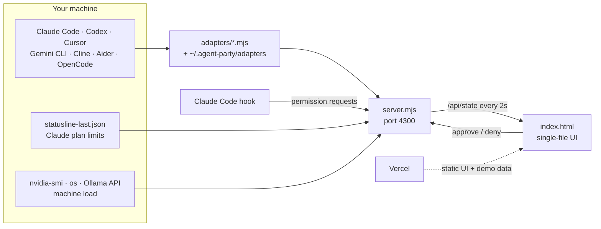

- **Incremental reads.** Log files are read from the last byte offset seen, so a 200 MB session costs nothing after the first pass.
- **Streaming-safe token counts.** Repeated chunks of the same streamed message replace each other instead of being added twice.
- **Read-only, local-only.** The server binds to `127.0.0.1`, never writes to any agent's files and opens every database read-only. Hiding a session only hides it on the dashboard. Agent Party writes its own files in `~/.agent-party/` (budgets, lifetime XP, paired devices). The one exception is `--install-hooks`, which edits `~/.claude/settings.json` only when you run it, after asking, with a backup.
- **Paired devices only.** With `--lan`, anything that isn't this computer needs a pairing token for every request except the page itself.
- **Native notifications without packages.** Budget alerts use what the OS already has: a PowerShell toast on Windows, `osascript` on macOS and `notify-send` on Linux.
- **One adapter per tool.** Each source is a small file that returns a list of sessions, so adding a tool never touches the core.
- **Zero dependencies.** Plain Node and one HTML file, with no bundler and no framework.

<details>
<summary><b>Status rules</b></summary>

<br>

| Status | Meaning |
| :-- | :-- |
| `ACTIVE` | Session file written in the last 2 minutes |
| `IDLE` | Last write between 2 and 30 minutes ago, usually waiting for you |
| `SLEEPING` | Quiet for more than 30 minutes |

</details>

<details>
<summary><b>Claude plan limits</b></summary>

<br>

The 5-hour and weekly usage bars come from `~/.claude/statusline-last.json`. Have your Claude Code status line script save the JSON it receives on stdin to that file, and the panel fills in on the next refresh.

</details>

<details>
<summary><b>Deploy your own copy</b></summary>

<br>

The hosted version is just `index.html` served as a static file. With the Vercel CLI:

```bash
vercel deploy --prod
```

`.vercelignore` allowlists `index.html` and `vercel.json` only, so the server, local caches and screenshots never get uploaded. When the page can't find `/api/state` it switches to demo data. Add `?demo` to any URL to force demo mode.

</details>

<br>

<div align="center">
<sub>Built for people who run more agents than they have terminal tabs.</sub>
</div>

## Contributing

The most useful contribution is a new adapter: one file that teaches Agent Party to read another tool. [ADAPTERS.md](ADAPTERS.md) has the contract, the helpers and a full example. Bug reports and new character classes are welcome too, in [issues](https://github.com/jvitorbarros15/agent-dashboard/issues).

## License

[MIT](LICENSE). Use it, fork it, make your own party.
