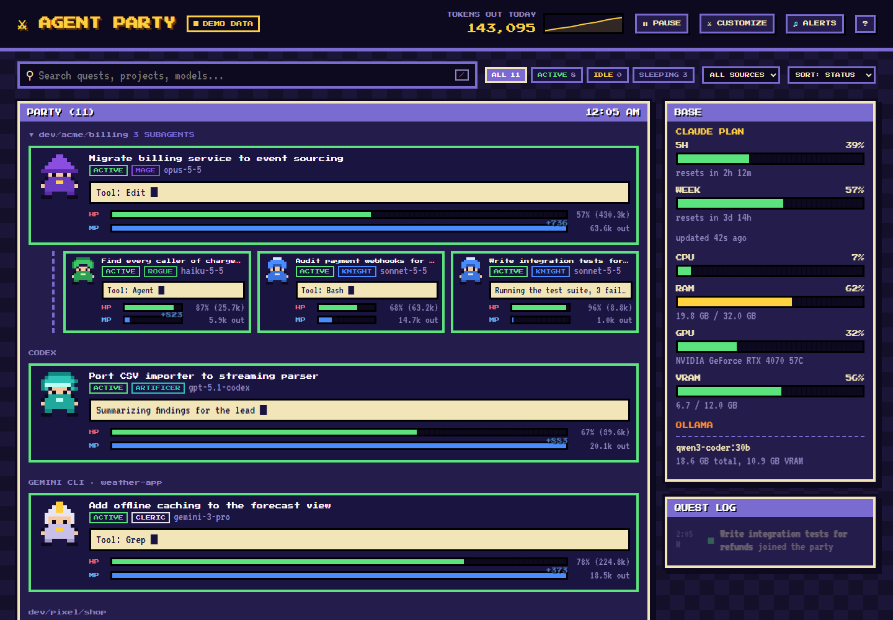
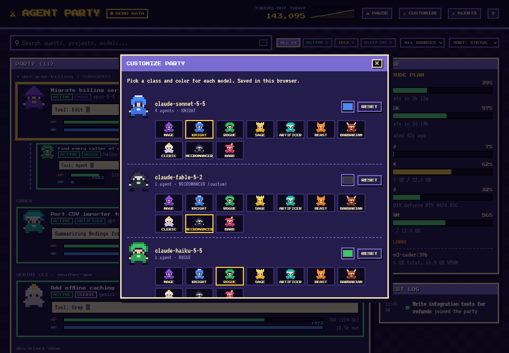
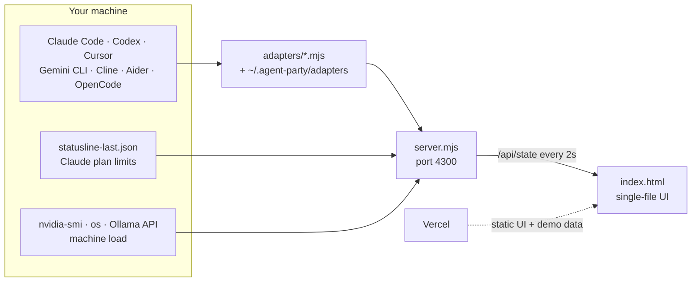

<div align="center">


<br>

[](https://agent-dashboard-pi-seven.vercel.app)
[](https://www.npmjs.com/package/agentparty)
[](#quick-start)
[](#how-it-works)
[](LICENSE)
[](https://agent-dashboard-pi-seven.vercel.app)

**A zero-dependency, pixel-art dashboard that shows every AI coding agent on your machine,<br>what it is doing right now, how much context it has left, and how hard your hardware is working.**

```bash
npx agentparty
```

[Try the demo](https://agent-dashboard-pi-seven.vercel.app) · [Quick start](#quick-start) · [Supported tools](#supported-tools) · [Customize](#customize-your-party) · [Write an adapter](ADAPTERS.md)

<br>


</div>

<br>

## Why

Running several Claude Code sessions, a handful of subagents, a Codex job and a Cursor chat at the same time gets hard to follow from terminal tabs and editor panels. Agent Party reads the session logs those tools already write and turns them into one live screen: who is working, who is waiting for you, who is about to run out of context, and what each one is doing right now.

Each agent is a party member. Its **HP** is the context window it has left, its **MP** is the tokens it has produced, and its class comes from the model behind it. You can [change any of them](#customize-your-party).

| Class | Default for | | Class | Default for |
| :-- | :-- | :-: | :-- | :-- |
| 🟣 **Mage** | Claude Opus | | 🩵 **Artificer** | GPT, Codex, o-series |
| 🔵 **Knight** | Claude Sonnet | | ⚪ **Cleric** | Gemini |
| 🟢 **Rogue** | Claude Haiku | | 🟠 **Beast** | Anything else |
| 🟡 **Sage** | Claude Fable | | 🔴 🖤 🩷 | **Barbarian**, **Necromancer**, **Bard**: yours to assign |

## Features

<table>
<tr>
<td width="50%" valign="top">

**🗡️ Party view**
- Sessions from [7 tools](#supported-tools) over the last 24 hours, in one view
- Subagents nested under the session that spawned them, collapsible per project
- Live activity bubble: the current tool call or the latest line of output
- Floating `+1.2k` token gains and a spawn animation when a subagent joins

**🔎 Find things fast**
- Search across titles, prompts, projects, models and session IDs
- Status filters with live counts: active, idle, sleeping
- Sort by status, recency, tokens or context pressure
- Filters and collapsed groups persist between visits

</td>
<td width="50%" valign="top">

**📜 Quest log and alerts**
- Running feed of agents joining, finishing a turn, waking up and going idle
- On-screen toasts, plus optional desktop notifications when an agent finishes while the tab is in the background
- Active agent count in the browser tab title

**🧭 Agent details**
- Click any card for the original prompt, model, context, tokens and last-seen time
- One-click copy of the session ID or the exact `claude --resume` / `codex resume` command

**🎨 Customize your party**
- Ten classes to choose from, per model, with any color
- Share your party with a link

**🏰 Base panel**
- Claude plan usage for the 5-hour and weekly windows, with reset countdowns
- CPU, RAM, GPU and VRAM load, and the models Ollama has loaded

</td>
</tr>
</table>

<div align="center">


</div>

## Quick start

```bash
npx agentparty
```

Your browser opens on **http://127.0.0.1:4300**. That's it: no install, no build step, no config. It needs Node 22.13 or newer.

<details>
<summary><b>Options</b></summary>

<br>

```text
npx agentparty --port 4400        # another port
npx agentparty --no-open          # don't open the browser
npx agentparty --disable cursor   # skip some adapters
npm i -g agentparty && agentparty # install once, run anywhere
```

Or run it from a clone: `git clone https://github.com/jvitorbarros15/agent-dashboard.git && cd agent-dashboard && node server.mjs`.

</details>

## Supported tools

| Tool | What it reads | Subagents | Context | Tokens |
| :-- | :-- | :-: | :-: | :-: |
| **Claude Code** | `~/.claude/projects/**/*.jsonl` | ✅ | ✅ | ✅ |
| **Codex CLI** | `~/.codex/sessions/**/*.jsonl` | ✅ | ✅ | ✅ |
| **Cursor** | Cursor's `state.vscdb` (read-only) | ✅ | ✅ % | ✅ |
| **Gemini CLI** | `~/.gemini/tmp/*/chats/*.json` | | ✅ | ✅ |
| **Cline** / Roo Code | Editor `globalStorage/.../tasks/*` | | ✅ | ✅ |
| **Aider** | `.aider.chat.history.md` in your repos | | | ✅ |
| **OpenCode** | `opencode.db` (read-only) | | | ✅ |

Using something else? An adapter is one small file. See **[ADAPTERS.md](ADAPTERS.md)**: drop it into `~/.agent-party/adapters/` and it loads on the next start.

> [!TIP]
> Aider writes its history inside each repo, so Agent Party looks two folders deep under your home and common code folders. Point it elsewhere with `AGENT_PARTY_AIDER_DIRS=/path/one:/path/two`.

## Customize your party

Press <kbd>C</kbd> or click **CUSTOMIZE** to pick a class and color for each model you use. Choices are saved in your browser, and **COPY SHARE LINK** gives you a URL that loads your party on anyone else's dashboard.

<div align="center"></div>

### Connect the hosted dashboard to your machine

The [hosted copy](https://agent-dashboard-pi-seven.vercel.app) runs on simulated data, since a website can't read files on your computer. To point it at your real agents, allow its origin when you start the local server:

```bash
DASHBOARD_ORIGINS=https://agent-dashboard-pi-seven.vercel.app npx agentparty
```

Then click the **DEMO DATA** badge and choose **Connect**, or open `https://agent-dashboard-pi-seven.vercel.app/?api=http://127.0.0.1:4300`. Chrome asks once for permission to reach your local network.

> [!IMPORTANT]
> The local API only answers cross-origin requests from origins listed in `DASHBOARD_ORIGINS`. Other websites you visit can't read your session data.

## Keyboard shortcuts

| Key | Action | | Key | Action |
| :-: | :-- | :-: | :-: | :-- |
| <kbd>/</kbd> | Search | | <kbd>J</kbd> <kbd>K</kbd> | Select next / previous agent |
| <kbd>1</kbd>–<kbd>4</kbd> | All / active / idle / sleeping | | <kbd>Enter</kbd> | Open selected agent |
| <kbd>S</kbd> | Cycle sort order | | <kbd>Esc</kbd> | Close panel, clear search |
| <kbd>P</kbd> | Pause live updates | | <kbd>?</kbd> | Show all shortcuts |
| <kbd>N</kbd> | Toggle "agent finished" alerts | | <kbd>C</kbd> | Customize classes and colors |

## How it works



- **Incremental reads.** Log files are read from the last byte offset seen, so a 200 MB session costs nothing after the first pass.
- **Streaming-safe token counts.** Repeated chunks of the same streamed message replace each other instead of being added twice.
- **Read-only, local-only.** The server binds to `127.0.0.1`, never writes to any agent's files and opens every database read-only.
- **One adapter per tool.** Each source is a small file that returns a list of sessions, so adding a tool never touches the core.
- **Zero dependencies.** Plain Node and one HTML file, with no bundler and no framework.

<details>
<summary><b>Status rules</b></summary>

<br>

| Status | Meaning |
| :-- | :-- |
| `ACTIVE` | Session file written in the last 2 minutes |
| `IDLE` | Last write between 2 and 30 minutes ago, usually waiting for you |
| `SLEEPING` | Quiet for more than 30 minutes |

</details>

<details>
<summary><b>Claude plan limits</b></summary>

<br>

The 5-hour and weekly usage bars come from `~/.claude/statusline-last.json`. Have your Claude Code status line script save the JSON it receives on stdin to that file, and the panel fills in on the next refresh.

</details>

<details>
<summary><b>Deploy your own copy</b></summary>

<br>

The hosted version is just `index.html` served as a static file. With the Vercel CLI:

```bash
vercel deploy --prod
```

`.vercelignore` allowlists `index.html` and `vercel.json` only, so the server, local caches and screenshots never get uploaded. When the page can't find `/api/state` it switches to demo data. Add `?demo` to any URL to force demo mode.

</details>

<br>

<div align="center">
<sub>Built for people who run more agents than they have terminal tabs.</sub>
</div>

## Contributing

The most useful contribution is a new adapter: one file that teaches Agent Party to read another tool. [ADAPTERS.md](ADAPTERS.md) has the contract, the helpers and a full example. Bug reports and new character classes are welcome too, in [issues](https://github.com/jvitorbarros15/agent-dashboard/issues).

## License

[MIT](LICENSE). Use it, fork it, make your own party.
